# BMU Table Plots

Auto-generated by `generate_ecu_table_plots.py`.

## Capacity

### A and Ah Limit for ReadDataByLocalIdentifier data

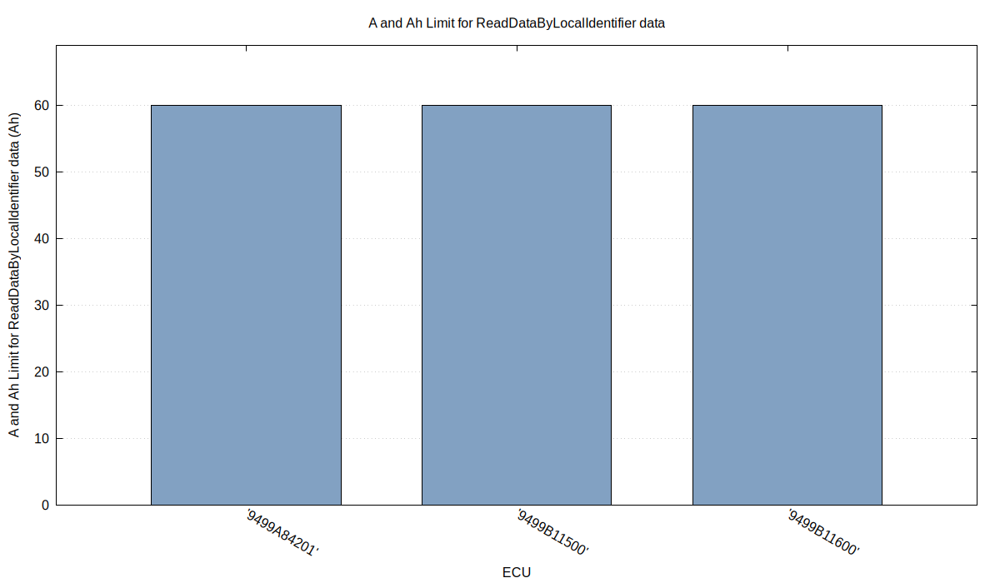

### Pack Aging Capacity Factor

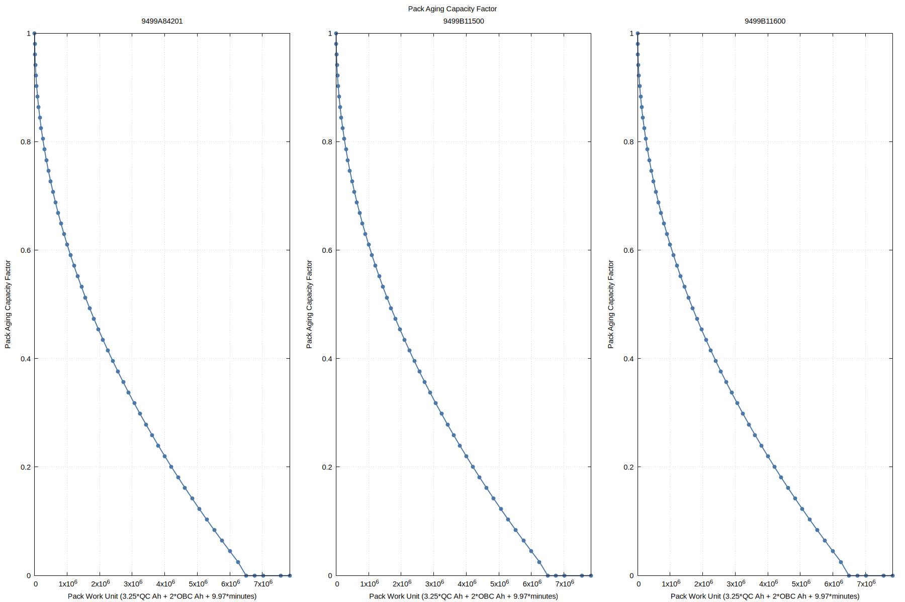

### Pack Ah Capacity Base value

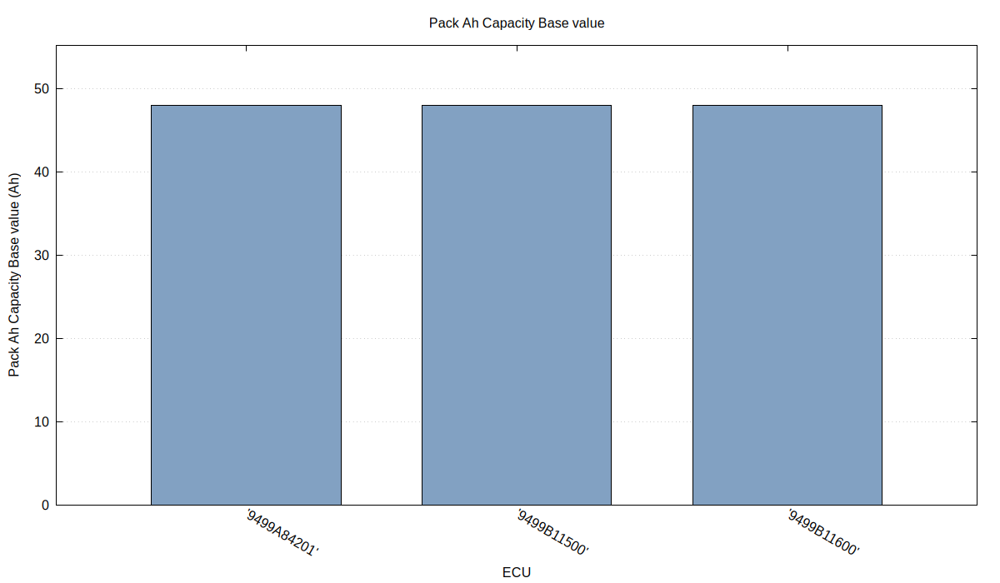

### Pack Ah Capacity Clamp

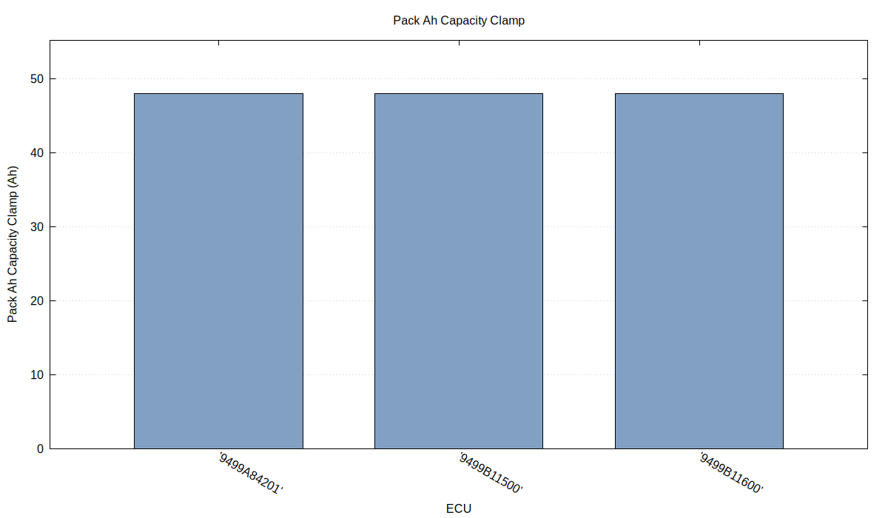

### Pack Ah Capacity in factor to Ah calc

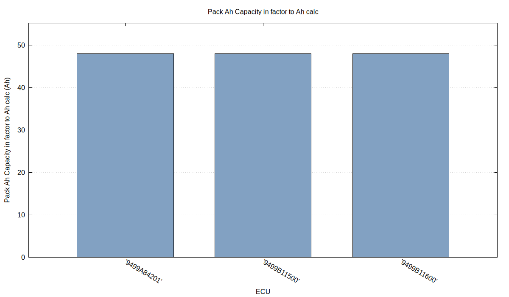

### Pack Ah Limit (Ah) in SOC and capacity calcs

### Pack Capacity Max (Ah) in data mapping function

## Battery

### Cell Voltage from SOC

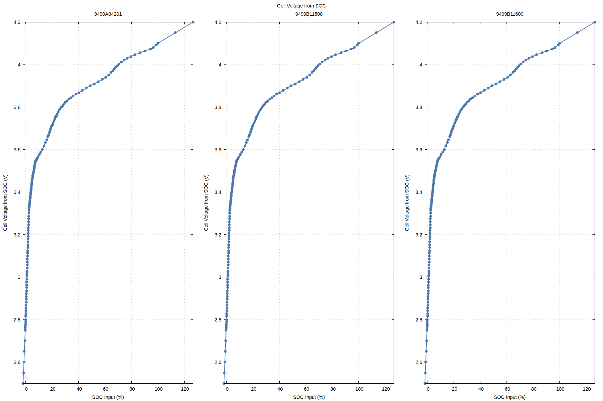

### Current Limit for Temperature

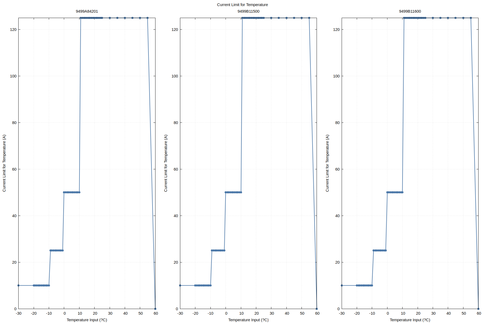

### SOC from Cell Voltage

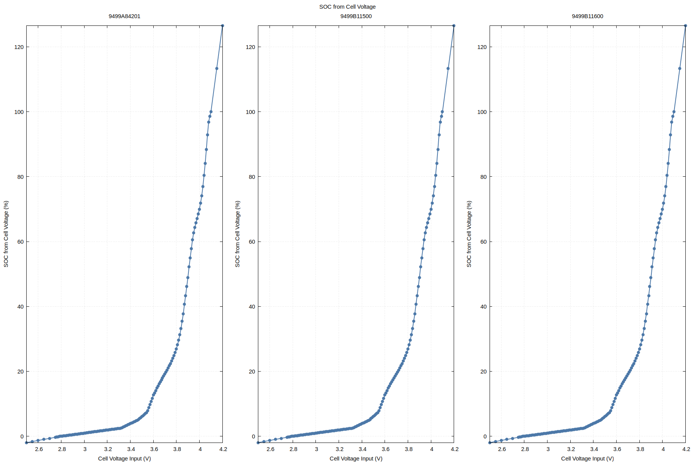

### SOC/Temperature Charge Limit

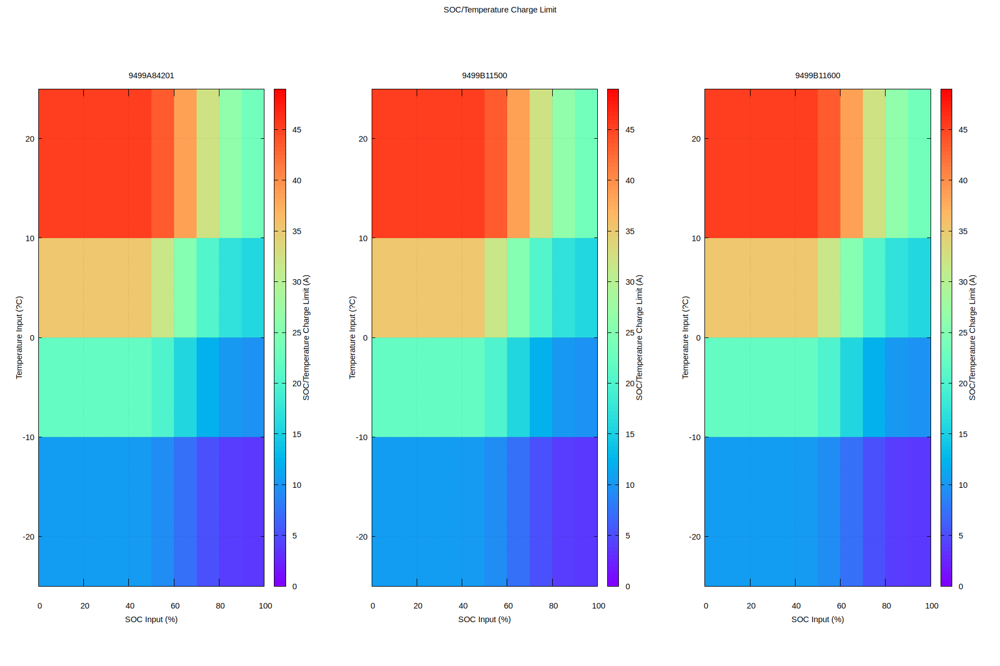

### SOC/Temperature Discharge Limit

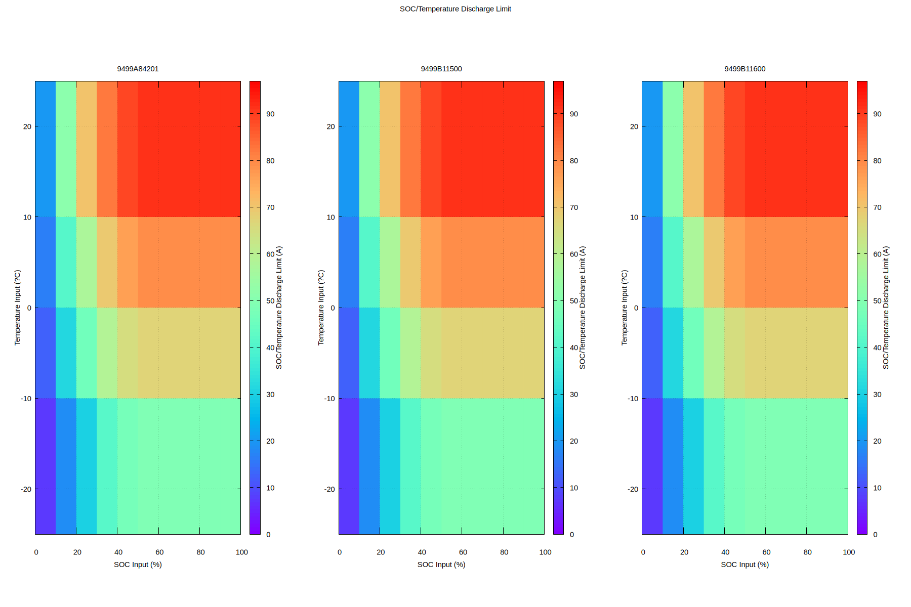

## Sensors

### ADC to Input Volts

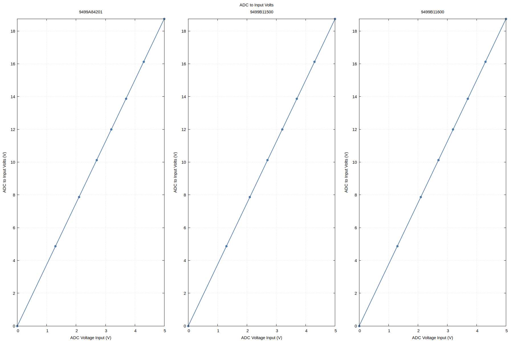

### Pack Current High from Current Sensor ADC

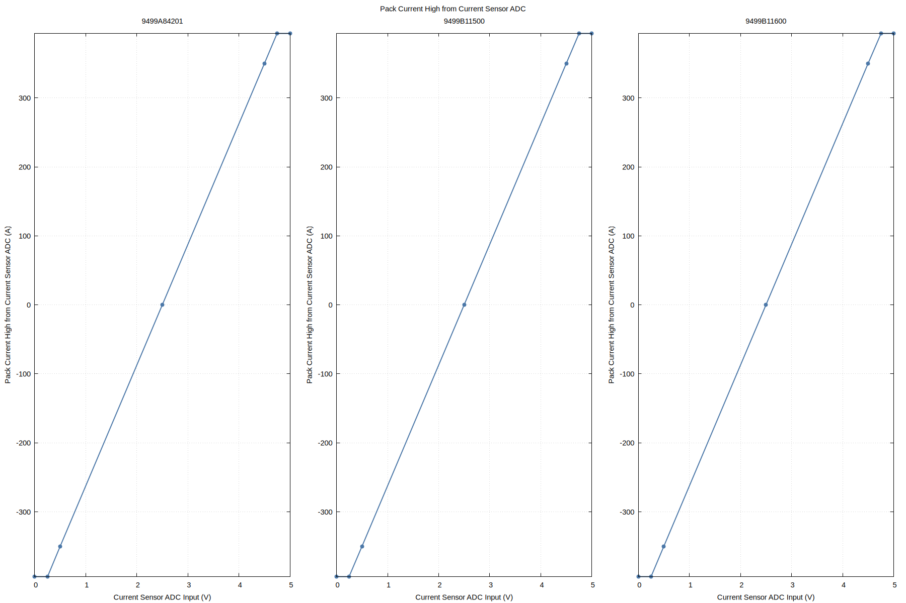

### Pack Current Low from Current Sensor ADC

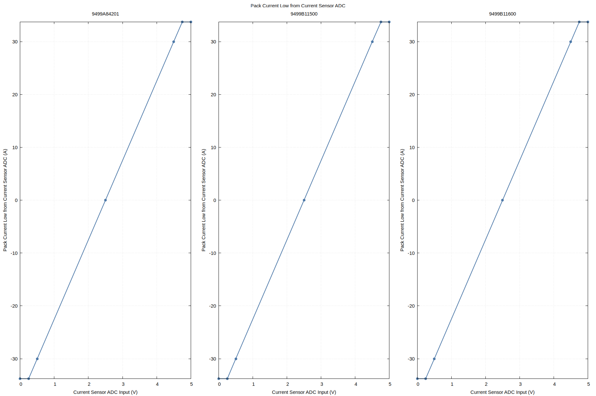
