# ECU Table Plots

Auto-generated by `generate_ecu_table_plots.py`.

## Chademo

### Chademo Battery Pack Capacity

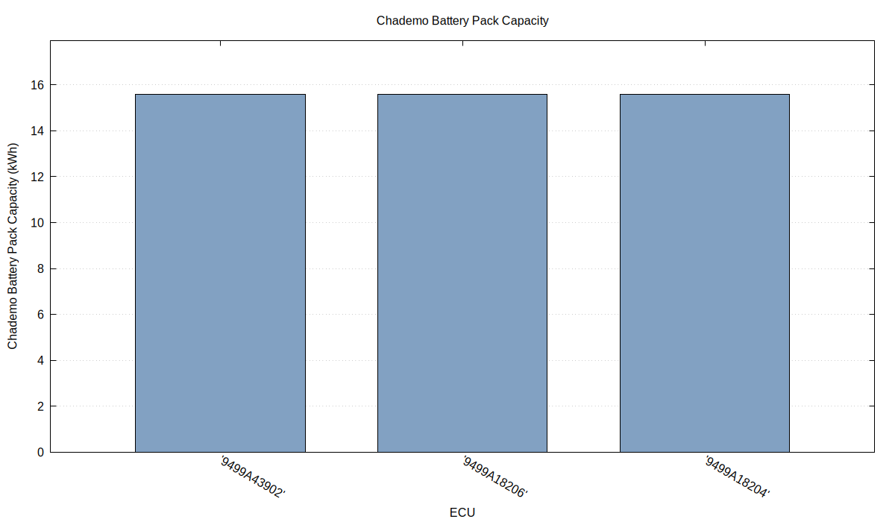

### Chademo Current Limit

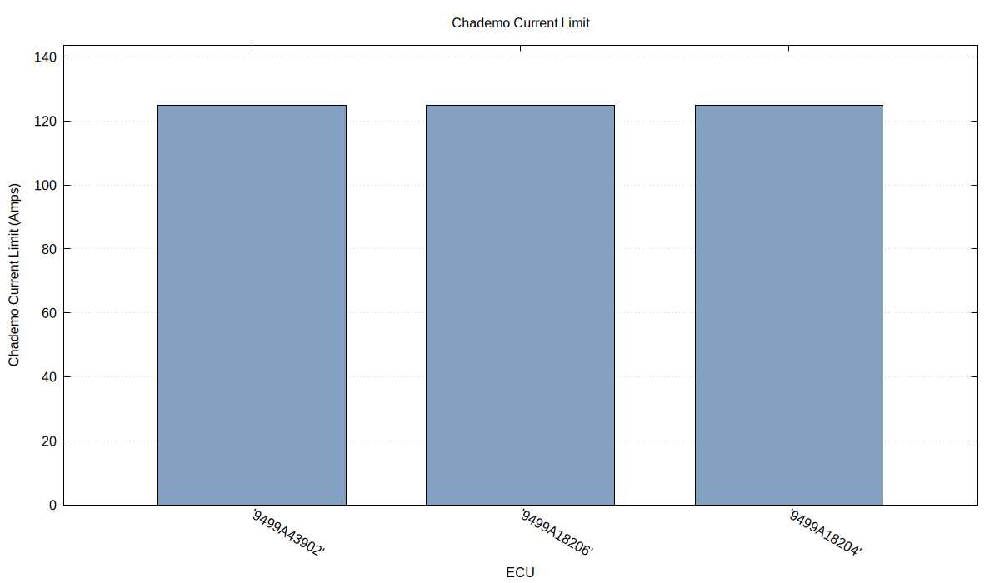

### High Temp QC Charge Current Limit

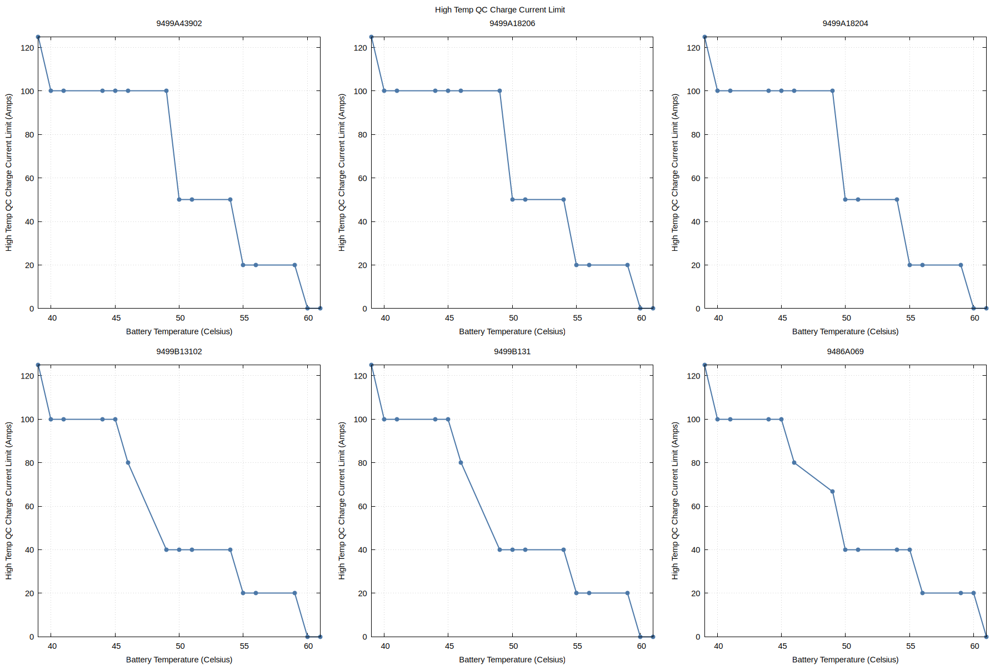

### High Temperature/SOC Charge Curve

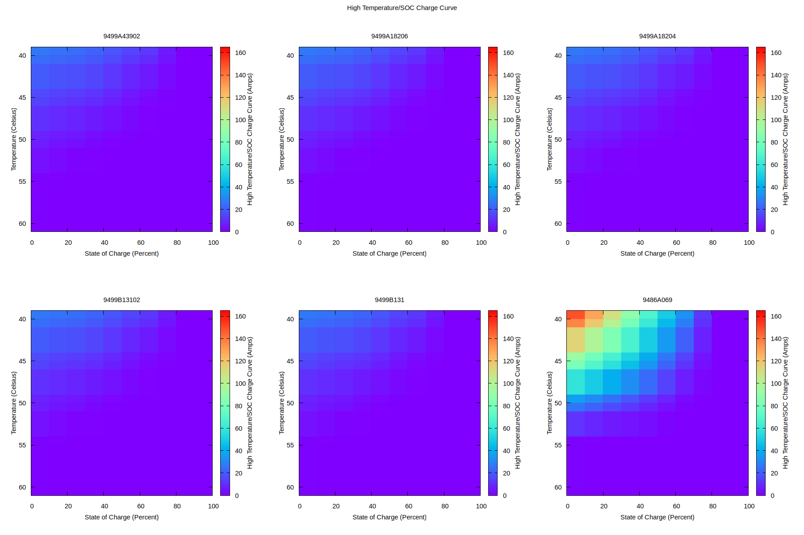

### Low Temp QC Charge Current Limit

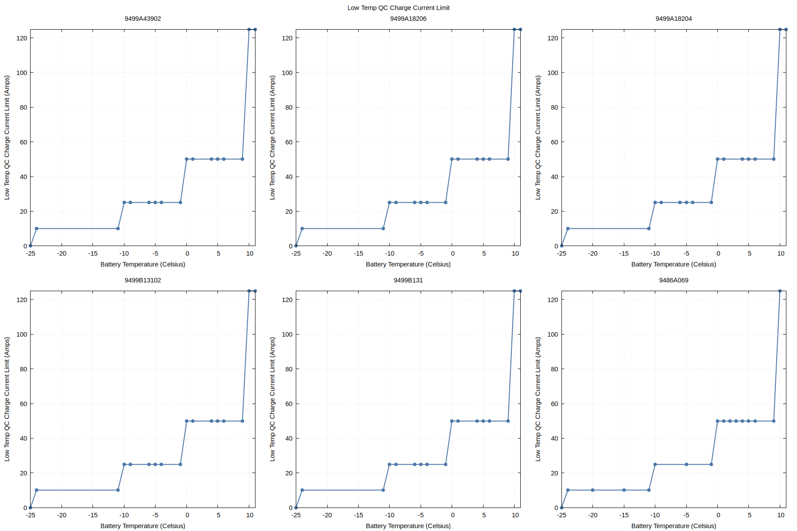

### Low Temperature/SOC Charge Curve

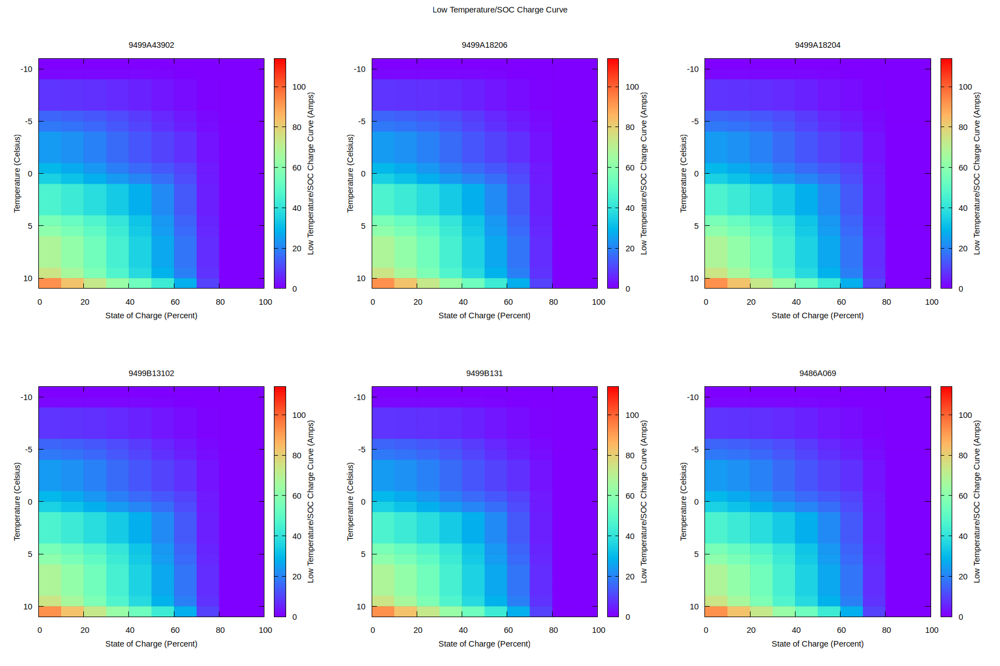

### QC Charge Time Limit by SOC

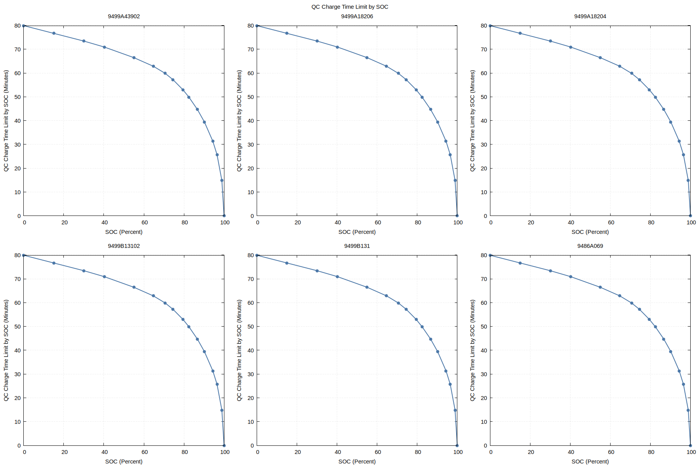

## Regen

### Max Battery Current For Low Temperature

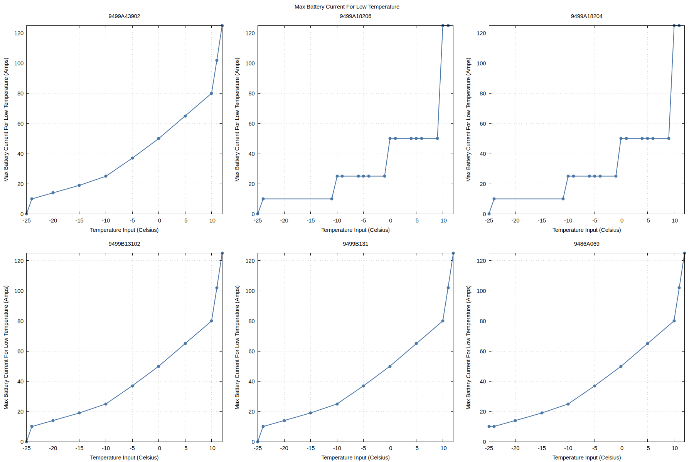

## OBC

### Max OBC Fast Cable Charge Time

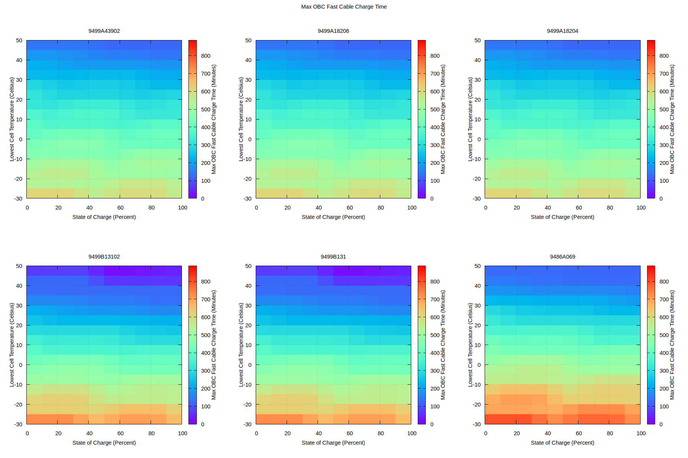

### Max OBC Slow Cable Charge Time

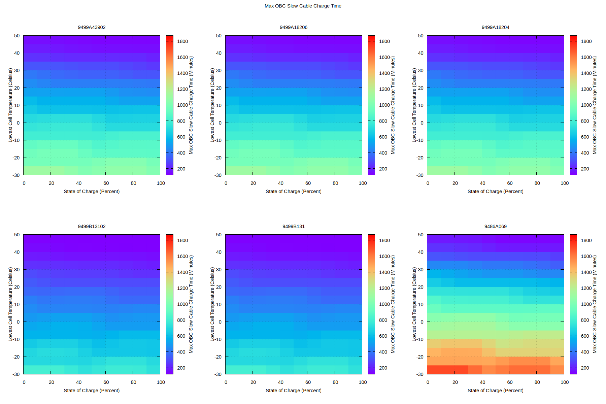

### OBC Max Charge Current For Temperature

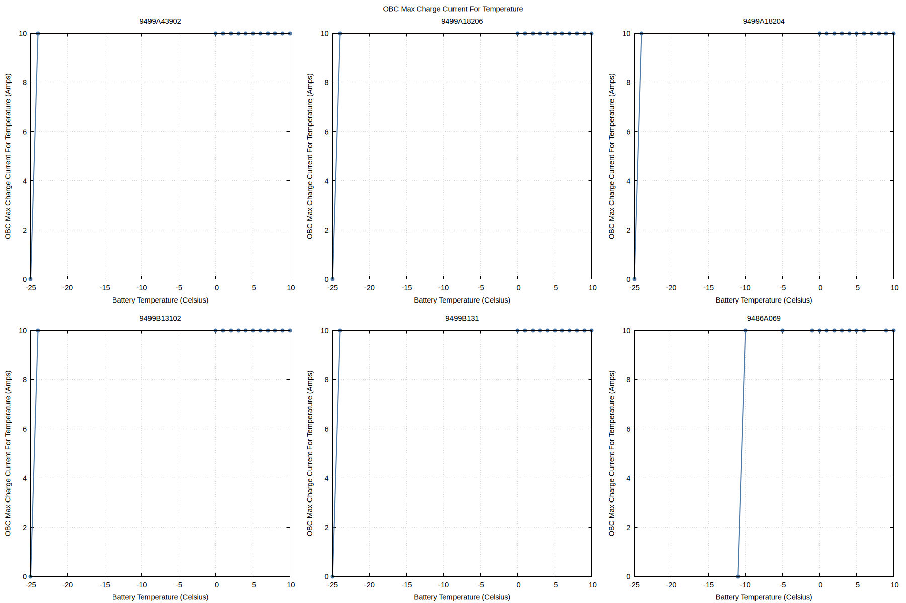
