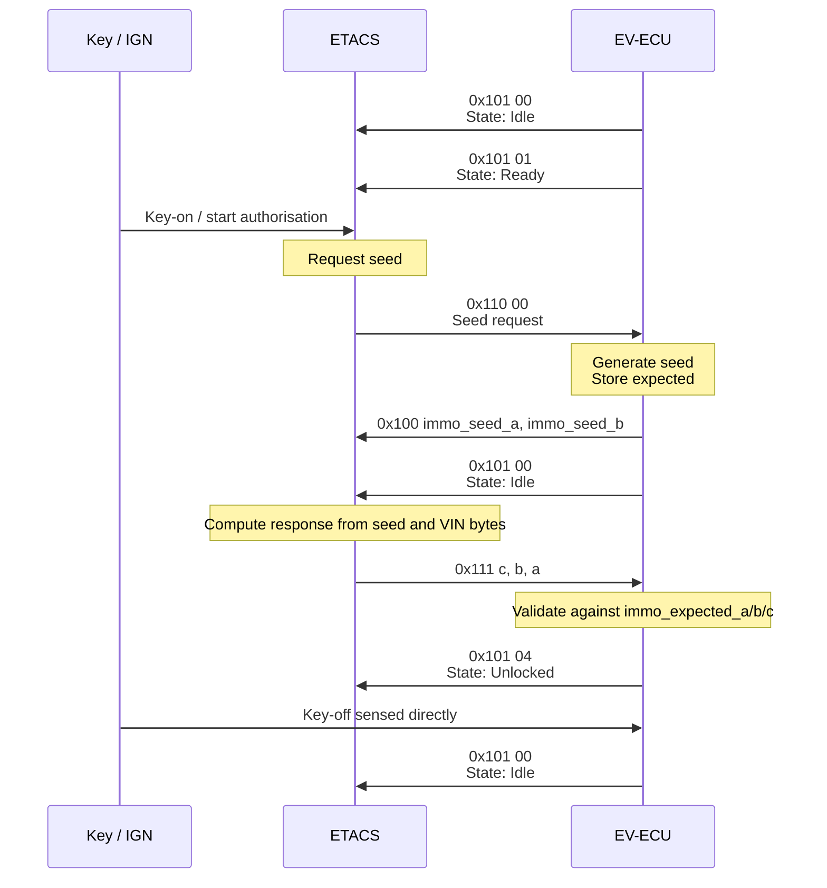

# EV-ECU immobiliser handshake

This note describes the immobiliser-related CAN exchange observed on the main vehicle CAN bus and how it matches the EV-ECU firmware.

## Summary


Observed roles on the bus:

- `0x110` is likely the immobiliser seed request from ETACS.
- `0x100` is the EV-ECU challenge frame carrying two derived 16-bit values.
- `0x111` is the ETACS response frame carrying the 3-byte immobiliser key.
- `0x101` is sent periodically by the EV-ECU as an immobiliser state indicator

Observed transmitter ownership:

- ETACS sends `0x110` and `0x111`.
- EV-ECU sends `0x100` and `0x101`.

Current observation for `0x101`:

- Seen transition sequence during the handshake: `00 -> 01 -> 00 -> 04`
- `04` is sent continuously thereafter
- The only additional observed transition is `04 -> 00` when the key is turned off.


## EV-ECU transmitted challenge

The EV-ECU firmware computes:

```c
immo_seed_a = immo_timer1_count ^ TMS1CT;
immo_seed_b = immo_seed_a * 5 + 0x77;
```

It then transmits those values in PID `0x100` as:

```c
pid_data.b0 = immo_seed_a_hi;
pid_data.b1 = immo_seed_a_low;
pid_data.b2 = immo_seed_b_hi;
pid_data.b3 = immo_seed_b_low;
```

So PID `0x100` carries the EV-ECU challenge material directly.

## VIN bytes used in the key calculation

The EV-ECU pulls four bytes from EEPROM shadow memory:

```c
vin[0] = eeprom_block_0_shadow_contains_vin[0x21]; // 17th
vin[1] = eeprom_block_0_shadow_contains_vin[0x20]; // 16th
vin[2] = eeprom_block_0_shadow_contains_vin[0x1e]; // 14th
vin[3] = eeprom_block_0_shadow_contains_vin[0x19]; // 9th
```

For EEPROM bytes starting at offset `0x11`,
the characters used by the algorithm are the 9th, 14th, 16th and 17th

```text
4A 4D 42 4D 4E 43 4A 31 39 59 55 30 39 37 32 30 39 00 00 00 00

J  M  B  M  N  C  J  1  9  Y  U  0  9  7  2  0  9
                        ^              ^     ^  ^
1  2  3  4  5  6  7  8  9  10 11 12 13 14 15 16 17     
```


## Expected response calculation

The EV-ECU starts from the low byte of `immo_seed_a` and both bytes of `immo_seed_b`:

```c
uVar4 = immo_seed_a & 0xff;
uVar3 = immo_seed_b >> 8;
uVar2 = immo_seed_b & 0xff;
```

Then it mixes in the four VIN bytes:

```c
for (uVar1 = 0; uVar1 < 4; uVar1 = uVar1 + 1) {
  uVar5 = (ushort)vin[uVar1];
  uVar2 = uVar5 ^ uVar2 + uVar5;
  uVar3 = uVar3 + uVar2;
  uVar4 = uVar5 ^ uVar4 + uVar3;
}

immo_expected_a = uVar2 & 0xff;
immo_expected_b = uVar3 & 0xff;
immo_expected_c = uVar4 & 0xff;
```


## ETACS response frame

The EV-ECU receives PID `0x111` as:

```c
immo_received_c = (word)*immo_data.pid_111_0;
immo_received_b = (word)(byte)*immo_data.pid_111_1;
immo_received_a = (word)(byte)*immo_data.pid_111_2;
```

So the on-wire order for PID `0x111` is `c, b, a`.

The EV-ECU then performs this check:

```c
if ((((immo_received_a == immo_expected_a) &&
      (immo_received_b == immo_expected_b)) &&
     (immo_received_c == immo_expected_c)) &&
    (((ushort)eeprom_state & 1) != 0)) {
  immo_state_a = immo_state_a & 0xffc3 | 0x210;
  immo_state_b = immo_state_b & 0xfeff;
}
```


## Current interpretation

The currently supported sequence is:

1. EV-ECU sends `0x101` messages every 100 ms broadcasting the immobiliser handshake state.
2. ETACS sends `0x110`, requesting an immobiliser seed.
3. EV-ECU replies with `0x100`, containing `immo_seed_a` and `immo_seed_b`.
4. ETACS calculates the 3-byte key from the challenge and VIN-derived bytes.
5. ETACS sends that key in `0x111` using on-wire byte order `c, b, a`.
6. EV-ECU validates the response and updates internal immobiliser state, reflected by the `0x101` transition to `04`.

The observed `04 -> 00` transition at key-off is driven by an ignition/key input sensed directly by the EV-ECU, not by a CAN message from ETACS.


